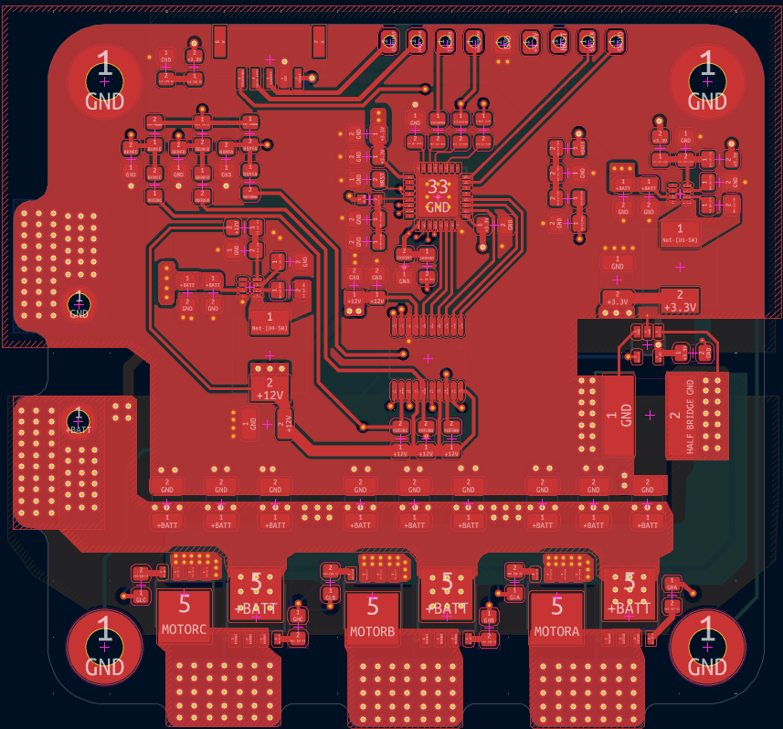
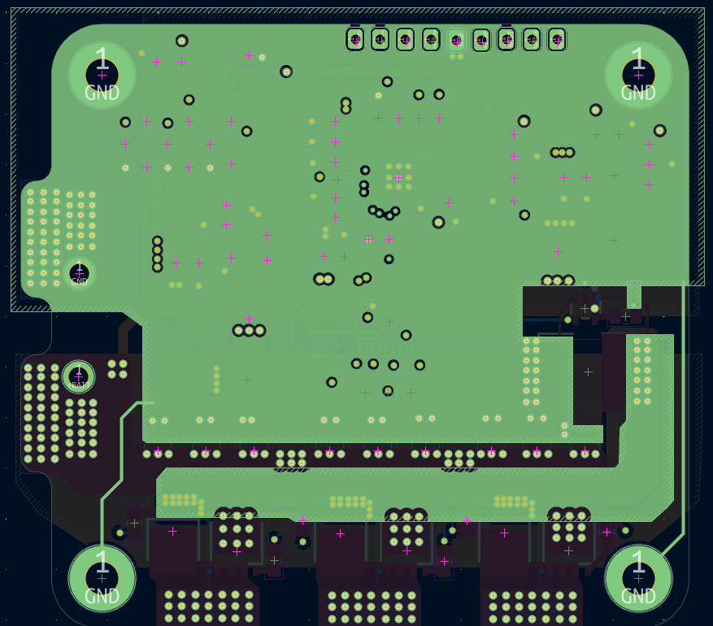
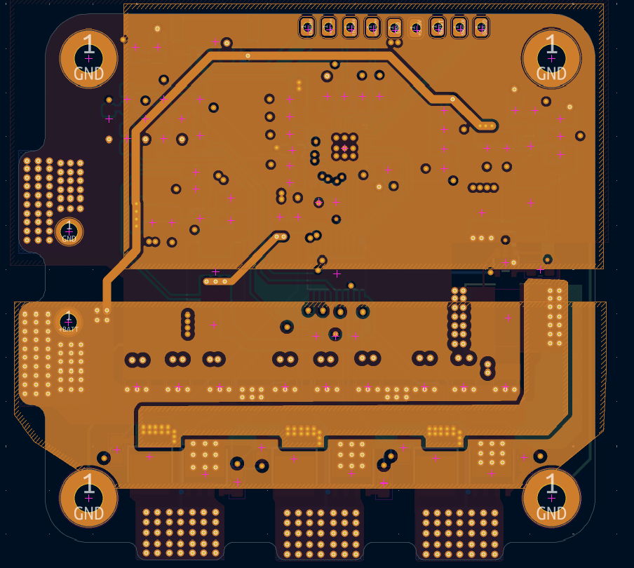
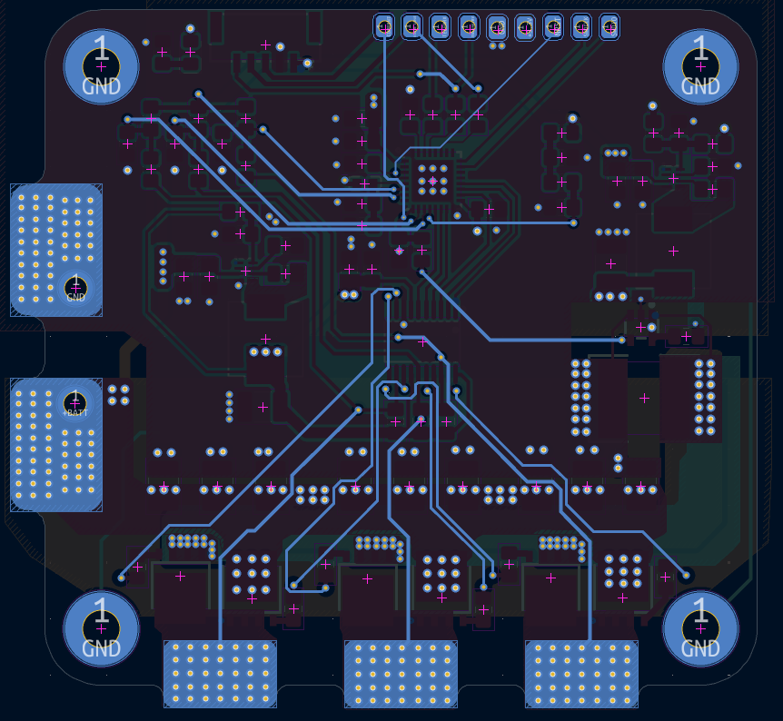
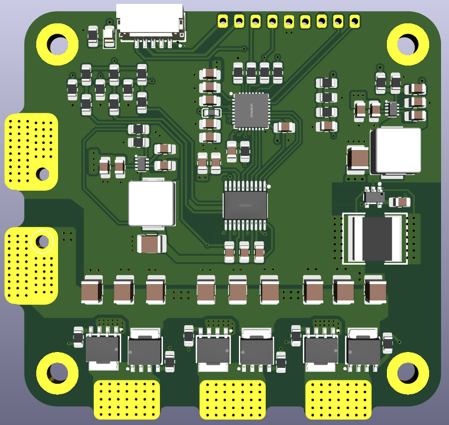

# Single ESC

An open-source hardware learning project for a three-phase electronic speed controller (ESC), designed in KiCad. I created this schematic and PCB while studying existing ESC circuits shared online to understand how their power supply, gate driver, motor bridge, and sensing stages work together.

This is the first PCB revision. I am currently ordering the board for fabrication; the hardware has not yet been assembled or tested.

---

## 1. Overview

The design combines a microcontroller, a three-phase gate driver, six power MOSFETs, and voltage and current sensing on a four-layer PCB. The schematic labels the intended battery input range as 14-25 V. This range is a design target, not a verified operating specification.

The main parts are:

| Function | Component |
|---|---|
| Microcontroller | STM32F051K8U7 |
| Three-phase gate driver | DRV8300DPWR |
| Motor bridge | Six PSMN1R4-40YLDX-VB MOSFETs |
| 3.3 V and 12 V supplies | Two TPS62932DRLR buck converters |
| Current measurement | INA180B2IDBVT amplifier and a 1 mΩ shunt |

The schematic also includes back-EMF sensing for the three motor phases, SWD programming pads, a signal input, telemetry connections, and test pads.

---

## 2. Schematic

The full schematic is available as a [PDF](ESC_PCB/test.pdf). It is divided into the power supplies, microcontroller, gate driver, back-EMF sensing, MOSFET bridge, connectors, and current-sensing sections.

---

## 3. PCB Design

The board is approximately 66.05 × 61.80 mm, with four copper layers and a 1.6 mm board thickness in the KiCad project.

### Top Layer

### GND Plane (Inner Layer 1)

### PWR Plane (Inner Layer 2)

### Bottom Layer

### 3D View

---

## 4. Project Files

| File / Folder | Description |
|---|---|
| `test.kicad_pro` | Main KiCad project settings |
| `test.kicad_sch` | Single ESC schematic source |
| `test.kicad_pcb` | Four-layer PCB layout source |
| `ESC_PCB/` | Schematic PDF and PCB images |
| `production/bom.csv` | Generated bill of materials |
| `production/positions.csv` | Generated component placement data |
| `production/designators.csv` | Generated designator list |
| `production/netlist.ipc` | Generated IPC netlist |
| `production/test.zip` | Generated Gerber and drill files |
| `test/` | A separate KiCad experiment; it is not part of the ESC design |

---

## 5. Current Status

The PCB is being ordered for the first prototype. Assembly, power-up checks, firmware, and motor testing are still pending. The design and fabrication files are shared for study and review, but the board should not be treated as a tested ESC.

---

## 6. References and Open Source

I drew this circuit while referring to existing ESC schematics and other circuits available on the internet. Those references helped me learn the operating principles of an ESC. I do not claim that every circuit idea in this design is original. Specific source links have not yet been collected; I will add attribution for identifiable references.

I intend to release the complete hardware project as open-source hardware. A formal license has not yet been selected and will be added before the public release.
